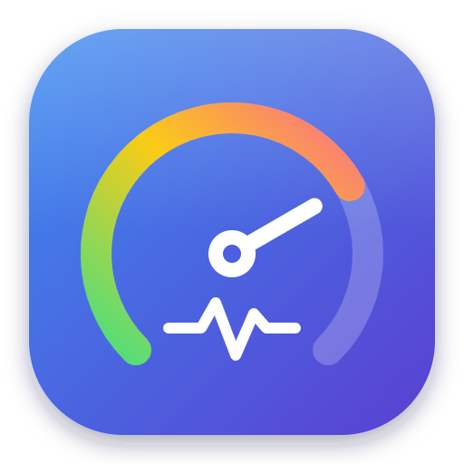
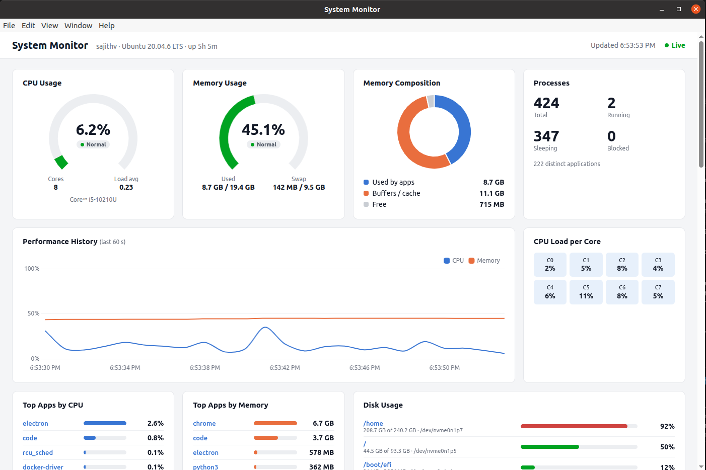

<p align="center">
  
</p>

<h1 align="center">Ubuntu System Monitor</h1>

<p align="center">
  A clean, real-time desktop dashboard for Ubuntu that shows CPU, memory, disk usage
  and every running application, built with Electron and Chart.js.
</p>

<p align="center">
  
</p>

---

## Features

- **Live overview** (updates every second): CPU and memory gauges, memory composition (apps / buffers & cache / free), swap, load average, uptime.
- **Performance history**: CPU and memory over the last 60 seconds.
- **Per-core load**: one tile per CPU core, shaded by load.
- **Running applications**: processes grouped by application (e.g. all `chrome` processes in one row), with CPU %, memory and process count. Sort by CPU or memory, filter by name.
- **Application details**: click any app to see its CPU and memory history and every process (PID, user, state, full command line).
- **Kill processes**: end a single process or all processes of an app (asks for confirmation first; sends `SIGTERM`).
- **Disk usage**: every mounted filesystem, coloured by how full it is.
- **Storage browser**: click a disk to browse its folders, with the largest files and folders listed first.

## Install

Download the latest release from the
[Releases page](https://github.com/sajith4u/SysPulse/releases):

- **`.deb` (Ubuntu / Debian):** installs the app with a launcher icon in the app menu.

  ```bash
  sudo apt install ./ubuntu-system-monitor-1.0.0-amd64.deb
  ```

  Uninstall with `sudo apt remove ubuntu-system-monitor`.

- **AppImage (any Linux):** a single file, no installation needed.

  ```bash
  chmod +x ubuntu-system-monitor-1.0.0-x86_64.AppImage
  ./ubuntu-system-monitor-1.0.0-x86_64.AppImage
  ```

  On Ubuntu 22.04 and newer, AppImages need FUSE 2: `sudo apt install libfuse2`.

## Requirements (to run from source)

- Ubuntu 20.04 or newer (other Linux distributions should work too)
- [Node.js](https://nodejs.org/) 18 or newer, and npm
- `du` (part of coreutils, installed on every Ubuntu system)

## Getting started

```bash
git clone https://github.com/sajith4u/SysPulse.git
cd SysPulse
npm install
npm start
```

`npm install` downloads the Electron runtime, so the first install can take a minute.

> **Running from the VS Code terminal?** VS Code may set `ELECTRON_RUN_AS_NODE=1`,
> which makes Electron start as plain Node and fail. Start it with:
>
> ```bash
> env -u ELECTRON_RUN_AS_NODE npm start
> ```

## Building the executable

Packages are built with [electron-builder](https://www.electron.build/); its settings are in the `build` section of `package.json`.

```bash
npm install
npm run dist            # AppImage + .deb
npm run dist:appimage   # AppImage only
npm run dist:deb        # .deb only
```

The output goes to `dist/`:

| File | What it is |
|---|---|
| `ubuntu-system-monitor-<version>-x86_64.AppImage` | Portable single-file executable |
| `ubuntu-system-monitor-<version>-amd64.deb` | Ubuntu/Debian package (installs to `/opt/Ubuntu System Monitor`, adds a launcher icon) |
| `linux-unpacked/` | The unpacked app; run `dist/linux-unpacked/ubuntu-system-monitor` to test a build quickly |

The first build downloads Electron and packaging tools (about 200 MB), so it takes a few minutes. Later builds are faster.
Build on Linux, x64. Use the same `env -u ELECTRON_RUN_AS_NODE` prefix if you build from the VS Code terminal.

**Releasing a new version:**

1. Bump `version` in `package.json` (e.g. `npm version minor`).
2. Run `npm run dist`.
3. Create a GitHub release and upload the `.AppImage` and `.deb` from `dist/`.

### Permissions

The app runs as your user. It can kill your own processes and browse the folders you can read.
Processes and folders owned by `root` or other users show **"Permission denied"**.
Running the app with `sudo` is not recommended.

## How it works

The app is plain JavaScript with no build step and no frontend framework.

```
src/
├── main.js          Electron main process: collects metrics, handles IPC
├── preload.js       Safe bridge between main and renderer (contextBridge)
└── renderer/
    ├── index.html   Dashboard layout
    ├── style.css    Styles (colours are CSS variables at the top)
    └── app.js       Charts and UI logic
assets/
├── icon.svg         App icon source
└── icon.png         App icon used by the window (512×512)
```

**Data flow:**

1. **Main process** (`src/main.js`) polls the [`systeminformation`](https://systeminformation.io/) library once per second for CPU, memory and processes, groups processes by application name, and sends one `system-metrics` message to the window. Disk usage refreshes separately every 10 seconds.
2. **Preload** (`src/preload.js`) exposes a small API, `window.systemMonitor`, to the page. The renderer runs with `contextIsolation` on and `nodeIntegration` off, so this is the only way the page can reach the system:
   - `onMetrics(callback)`: receive live metrics
   - `killProcess(pid)`: send `SIGTERM` to a process (the PID is validated in the main process)
   - `listDir(path)`: list a folder's contents
   - `dirSizes(path)`: measure subfolder sizes with `du` (one scan at a time, cached for 5 minutes)
3. **Renderer** (`src/renderer/app.js`) draws the dashboard with [Chart.js](https://www.chartjs.org/) and plain DOM code.

### Adding a new metric

1. Collect it in `getSystemMetrics()` in `src/main.js`.
2. Add an element for it in `src/renderer/index.html`.
3. Render it from `updateDashboard()` in `src/renderer/app.js`.

The preload passes the whole metrics object through, so it only changes when you add a new kind of request from the page to the main process.

### Changing the icon

Edit `assets/icon.svg`, then export it as a 512×512 PNG to `assets/icon.png`
(for example with Inkscape, or `rsvg-convert -w 512 -h 512 assets/icon.svg -o assets/icon.png`).

## Contributing

Contributions are welcome!

1. Fork the repository and create a branch: `git checkout -b my-feature`
2. Make your change and check it by running the app with `npm start`.
3. Open a pull request describing what you changed and why, with a screenshot for UI changes.

Please keep the project dependency-light: prefer the standard library, Electron APIs, or the existing
dependencies (`systeminformation`, `chart.js`) over adding new packages.

For bugs and feature ideas, open an issue with your Ubuntu version, Node.js version and steps to reproduce.

## License

[MIT](LICENSE)
